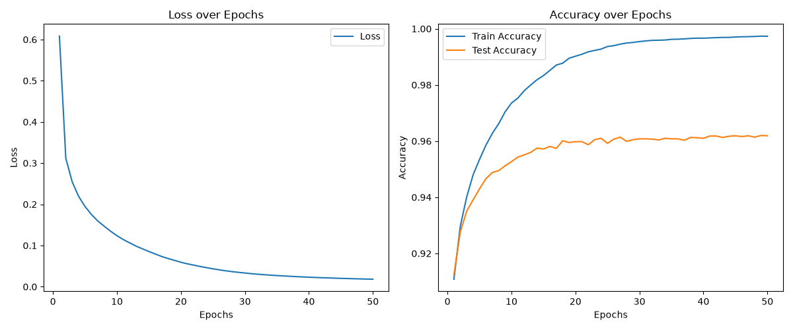

# NumPy Neural Network — MNIST手書き数字認識

深層学習フレームワークを使わず、**NumPyだけで3層ニューラルネットワークをフルスクラッチ実装**し、MNIST手書き数字を分類するプログラムです。



## 概要

| 項目 | 内容 |
|---|---|
| 開発形態 | 個人開発 |
| 背景 | 大学の実験（計算機科学実験及演習4 画像認識）の一環として実装 |
| 言語 | Python 3 |
| 使用ライブラリ | NumPy, Matplotlib, `mnist`（データ読み込みのみ） |
| モデル | 入力784 → 隠れ層1000（sigmoid）→ 出力10（softmax） |
| 損失関数 | クロスエントロピー |
| 学習 | ミニバッチSGD（バッチサイズ100、学習率0.01、50エポック） |
| 結果 | テスト正答率 約95% |

## 実装したこと

- **順伝播**：全結合層・sigmoid・softmaxを行列演算で実装（[`layers.py`](layers.py) の `forward`）
- **誤差逆伝播**：各パラメータの勾配を手計算で導出して実装（`backward`）
- **ミニバッチ学習**：`np.random.permutation` で毎エポック6万枚を重複なくシャッフルして学習（`train_one_epoch`）
- **数値的な安定化**
  - sigmoidの入力を `np.clip` して `exp` のオーバーフローを防ぐ
  - softmaxは各行の最大値を引いてから `exp` を計算
  - クロスエントロピーの `log` に小さな値 `eps` を足して `log(0)` を防ぐ
- **重みの初期化**：入力ノード数 N に対して標準偏差 1/√N の正規分布で初期化
- **評価**：メモリ節約のため、1万枚ずつに分けて正答率を計算
- **学習曲線の可視化**：損失・訓練精度・テスト精度の推移をグラフ化

## リファクタリングで工夫した点

課題ごとに「リファクタリング前・後」のコードを残し、同じ乱数シードで結果が一致することを確かめながら改善しました（[`report/src/`](report/src/)、[`verification/`](verification/)）。

- データの読み込みとミニバッチの選択を別の関数に分け、6万枚の読み込みを1回で済むようにした
- MNISTのパスを絶対パスから `pathlib` を使った相対パスに変え、別の環境でも動くようにした
- 実行部分を `main()` と `if __name__ == "__main__":` に移し、importしただけでは計算が走らないようにした
- パラメータを辞書でまとめて渡し、関数の引数を減らして読みやすくした
- マジックナンバー（255、784 など）を名前付きの定数にした

## 実行方法

```bash
pip install numpy matplotlib mnist
python layers.py
```

学習が終わると、学習曲線が `history.png` に保存されます。

## フォルダ構成

```
layers.py        本体（最新版）
demo_kadai2.py   課題2のデモ（ミニバッチを順伝播してクロスエントロピー誤差を計算）
mnist_data/      MNISTデータ
practice/        練習用のコード
verification/    レポートの数値・図を再現するプログラム
report/          レポート（LaTeX）と、各課題のリファクタリング前・後のソース
```
